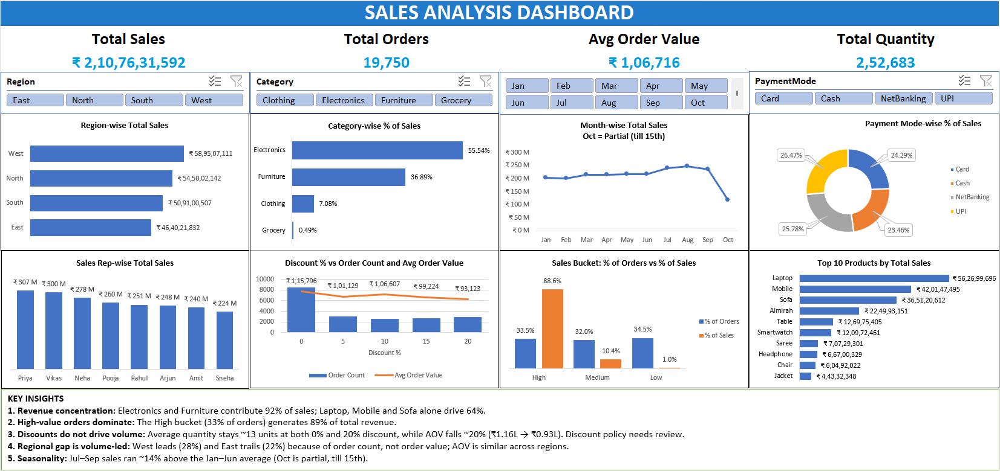

# Excel Sales Analysis Dashboard (2026)

An end-to-end sales analysis project in Microsoft Excel: raw data cleaning, formula-based analysis, PivotTables and an interactive dashboard with slicers.



## Project Overview

| Item | Detail |
|---|---|
| Dataset | 19,750 orders after cleaning (Jan 1 – Oct 15, 2026) |
| Total Sales | ₹2,10,76,31,592 (~₹210.76 Cr) |
| Avg Order Value | ₹1,06,716 |
| Total Quantity | 2,52,683 units |
| Tool | Microsoft Excel (Tables, PivotTables, Slicers, Charts, Lookup functions) |

**Workbook:** `Excel_Sales_Project_2026.xlsx`

| Sheet | Purpose |
|---|---|
| Raw_Data | Original data, untouched |
| Clean_Data | Cleaned table with derived columns |
| Analysis | Formula-based answers (SUMIFS, COUNTIFS, AVERAGEIFS, lookups) |
| Pivot_Table | 9 PivotTables used as the dashboard source |
| Dashboard | KPI cards, 8 charts, 4 slicers and key insights |

## Data Cleaning Steps

1. Converted the range into an Excel Table (`Ctrl + T`).
2. Removed **250 duplicate rows**.
3. Trimmed extra spaces in the `City` column (`TRIM`).
4. Standardised `Region` and `Product` to Proper case (`PROPER`).
5. Filled **849 missing TotalSales** values using `Quantity × UnitPrice × (1 − Discount%)`. This formula reproduces the existing values to within ₹0.01.
6. Created derived columns:
   - **Month** – month name from OrderDate
   - **Sales Level** – High / Medium / Low bucket based on TotalSales (High: > ₹75,000 | Medium: > ₹10,000 and ≤ ₹75,000 | Low: ≤ ₹10,000)
     `=IF([@TotalSales]>75000,"High",IF([@TotalSales]>10000,"Medium","Low"))`
   - **Net Per Unit** – effective price per unit after discount (TotalSales ÷ Quantity, equivalent to UnitPrice × (1 − Discount%))
     `=[@TotalSales]/[@Quantity]`

## Excel Functions Used

- **Conditional aggregation:** `SUMIFS`, `COUNTIFS`, `AVERAGEIFS`
- **Lookups** (Total Sales by Order ID, cross-checked across all five methods): `VLOOKUP`, `VLOOKUP + MATCH`, `INDEX + MATCH`, `OFFSET + MATCH`, `XLOOKUP`

## Dashboard Features

- 4 KPI cards: Total Sales, Total Orders, Avg Order Value, Total Quantity
- Interactive slicers: Region, Category, Month, Payment Mode
- Charts: Region-wise sales, Category % of sales, Monthly trend, Payment mode split, Sales-rep performance, Discount vs orders and AOV, Sales bucket (% of orders vs % of sales), Top 10 products

## Key Insights

1. **Revenue concentration:** Electronics (55.5%) and Furniture (36.9%) contribute 92% of sales. Laptop, Mobile and Sofa alone drive 64%. Grocery is 25% of orders but only 0.49% of sales.
2. **High-value orders dominate:** The High bucket (33.5% of orders) generates 88.6% of total revenue. The top 10% of orders account for ~53% of sales.
3. **Discounts do not drive volume:** Average quantity per order stays ~13 units at both 0% and 20% discount, while AOV falls ~20% (₹1.16 L → ₹0.93 L).
4. **Regional gap is volume-led:** West leads (28%) and East trails (22%) because of order count (5,505 vs 4,310), not order value. AOV is ₹1.05–1.08 L in every region. The same pattern holds across sales reps.
5. **Seasonality:** Jul–Sep sales ran ~14% above the Jan–Jun monthly average, with a peak in August (₹24.6 Cr). October is partial (till 15th), but its daily run-rate is in line with September.
6. **Balanced channels:** UPI (26.5%) and NetBanking (25.8%) lead slightly; no payment mode or city dominates (Pune is the top city at 9.8%).

## Recommendations

- Protect and grow the Electronics and Furniture lines, especially Laptop, Mobile and Sofa.
- Cap or target discounts: they cut order value without increasing quantity.
- Close the East and low-performing-rep gap through lead generation and order volume, not upselling.
- Plan inventory and campaigns around the Jul–Sep demand uplift.

## Repository Structure

```
├── Excel_Sales_Project_2026.xlsx   # Full workbook (all sheets)
├── Dashboard.png                   # Dashboard screenshot
└── README.md
```

## Author

**Abhinav Kamboj** – Data Analyst
